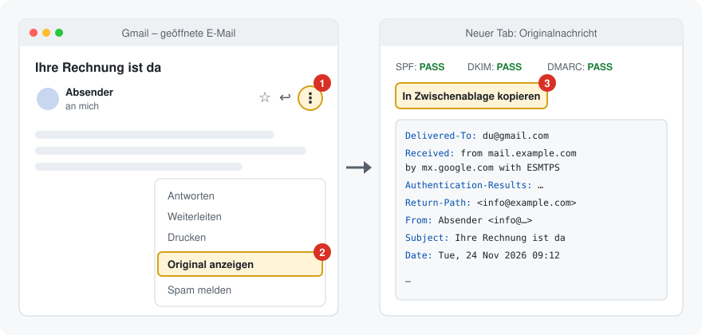
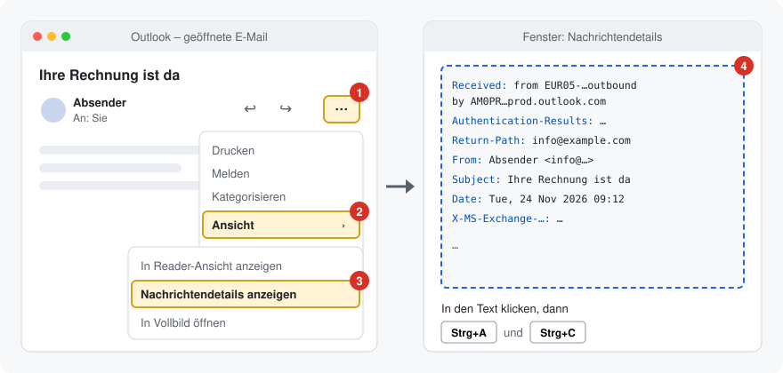
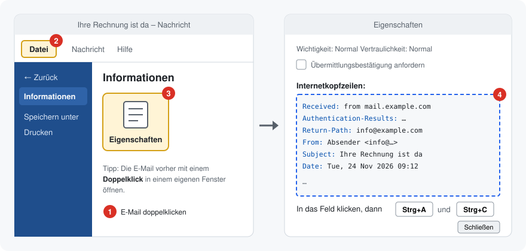

# 📥 So findest du die E-Mail-Header

🇬🇧 [English version](get-email-headers.md) · ⬅️ [Zurück zur README](../README.md)

Jede E-Mail hat zwei Teile: den **Text**, den du liest, und die **Header** (auch „Kopfzeilen“ genannt).
Die Header sind wie der Briefumschlag mit allen Poststempeln: Dort steht, **wer** die E-Mail geschickt hat, **über welche Server** sie gereist ist und **wann** sie wo angekommen ist.

Dein E-Mail-Programm zeigt die Header normalerweise nicht an. Mit den folgenden Schritten holst du sie hervor.

> 💡 **Kurz gesagt:** Header in deinem E-Mail-Programm kopieren → im [Email Header Analyzer](https://mailheader.mailtower.app) einfügen → fertig.

## Google Gmail (im Browser)

1. Öffne die E-Mail, die du prüfen möchtest.
2. Klicke oben rechts in der E-Mail auf die **drei Punkte ⋮** (neben dem Antworten-Pfeil).
3. Wähle **„Original anzeigen“**. Es öffnet sich ein neuer Tab.
4. Klicke auf **„In Zwischenablage kopieren“**.
5. Füge den Text im Email Header Analyzer ein (**Strg + V** bzw. **⌘ + V** auf dem Mac).

> 📱 In der Gmail-App auf dem Smartphone gibt es diese Funktion nicht. Öffne Gmail dafür im Browser auf dem Computer.

## Microsoft 365 / Outlook.com (Outlook im Web und neues Outlook)

Diese Anleitung gilt für **Outlook.com**, **Outlook im Web** (Microsoft 365, Arbeits- oder Schulkonto) und das **neue Outlook für Windows** – dort sehen die Menüs gleich aus.

1. Öffne die E-Mail, die du prüfen möchtest.
2. Klicke oben rechts in der E-Mail auf die **drei Punkte ···** („Weitere Aktionen“).
3. Gehe auf **„Ansicht“**.
4. Klicke auf **„Nachrichtendetails anzeigen“**. Es öffnet sich ein Fenster mit den Headern.
5. Klicke in den Text, markiere alles mit **Strg + A** und kopiere es mit **Strg + C**.
6. Füge den Text im Email Header Analyzer ein (**Strg + V**).

## Microsoft 365 – klassisches Outlook (Desktop-Programm für Windows)

1. Öffne die E-Mail mit einem **Doppelklick**, damit sie in einem eigenen Fenster erscheint.
2. Klicke oben links auf **„Datei“**.
3. Klicke auf **„Eigenschaften“**.
4. Unten im Fenster steht das Feld **„Internetkopfzeilen“** – das sind die Header.
5. Klicke in das Feld, markiere alles mit **Strg + A** und kopiere es mit **Strg + C**.
6. Füge den Text im Email Header Analyzer ein (**Strg + V**).

> 🔎 **Tipp:** Das Feld „Internetkopfzeilen“ ist klein – das macht nichts. Mit **Strg + A** wird trotzdem der ganze Inhalt markiert.

## Gut zu wissen

* ✅ **Kopiere immer alles.** Lieber zu viel als zu wenig – der Analyzer sucht sich die passenden Zeilen selbst heraus.
* 🔒 **Deine Daten bleiben bei dir.** Die Header werden nur in deinem Browser ausgewertet und nicht an einen Server geschickt.
* ⚠️ **Header enthalten persönliche Daten** wie E-Mail-Adressen und IP-Adressen. Teile sie nur mit Personen, denen du vertraust.
* ↪️ **Weitergeleitete E-Mails** haben neue Header. Prüfe deshalb immer die **Original-E-Mail** in deinem Postfach.
