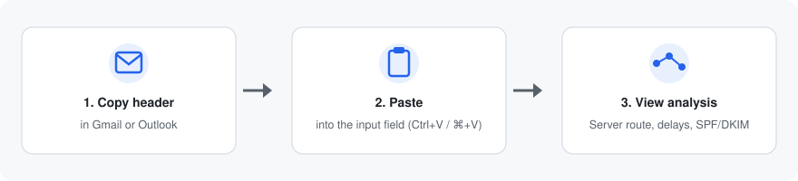
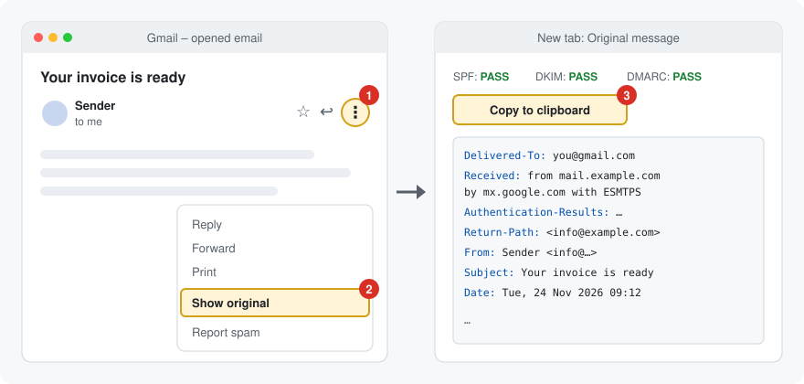
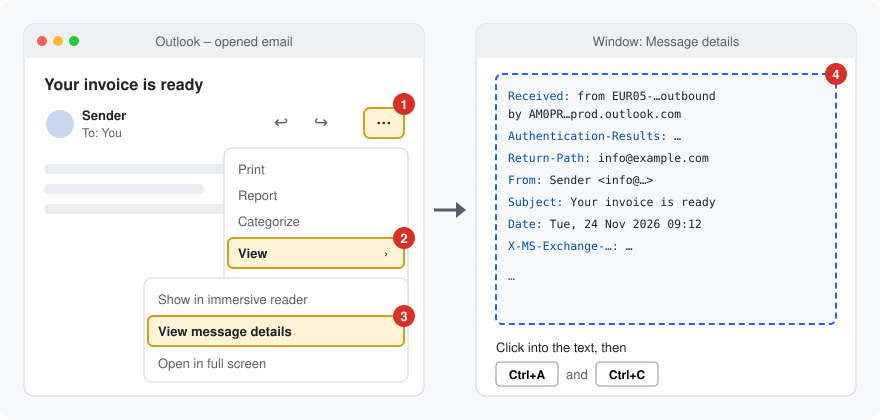
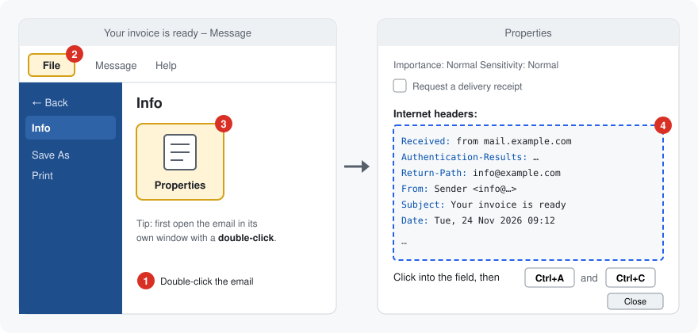

# 📥 How to Get the Email Header

🇩🇪 [Deutsche Version](get-email-headers.de.md) · ⬅️ [Back to README](../README.md)

Every email has two parts: the **text** you read, and the **header**.
The header is like the envelope of a letter with all its postmarks: it shows **who** sent the email, **which servers** it travelled through, and **when** it arrived where.

Your email program usually hides the header. The steps below show you how to get it.

> 💡 **In short:** Copy the header in your email program → paste it into the [Email Header Analyzer](https://mailheader.mailtower.app) → done.

## Google Gmail (in the browser)

1. Open the email you want to check.
2. Click the **three dots ⋮** in the top right of the email (next to the reply arrow).
3. Choose **“Show original”**. A new tab opens.
4. Click **“Copy to clipboard”**.
5. Paste the text into the Email Header Analyzer (**Ctrl + V**, or **⌘ + V** on a Mac).

> 📱 The Gmail app on your phone does not have this option. Open Gmail in a browser on your computer instead.

## Microsoft 365 / Outlook.com (Outlook on the web and new Outlook)

These steps work for **Outlook.com**, **Outlook on the web** (Microsoft 365, work or school account) and the **new Outlook for Windows** – the menus look the same in all of them.

1. Open the email you want to check.
2. Click the **three dots ···** (“More actions”) in the top right of the email.
3. Go to **“View”**.
4. Click **“View message details”**. A window with the header opens.
5. Click into the text, select everything with **Ctrl + A** and copy it with **Ctrl + C**.
6. Paste the text into the Email Header Analyzer (**Ctrl + V**).

## Microsoft 365 – classic Outlook (desktop app for Windows)

1. Open the email with a **double-click** so it opens in its own window.
2. Click **“File”** in the top left.
3. Click **“Properties”**.
4. At the bottom of the window you will see the **“Internet headers”** field – this is the header.
5. Click into the field, select everything with **Ctrl + A** and copy it with **Ctrl + C**.
6. Paste the text into the Email Header Analyzer (**Ctrl + V**).

> 🔎 **Tip:** The “Internet headers” field is small – that's fine. **Ctrl + A** still selects the whole content.

## Good to Know

* ✅ **Always copy everything.** Too much is better than too little – the analyzer picks out the relevant lines by itself.
* 🔒 **Your data stays with you.** The header is analyzed only in your browser and is not sent to a server.
* ⚠️ **Headers contain personal data** such as email addresses and IP addresses. Only share them with people you trust.
* ↪️ **Forwarded emails** get a new header. Always check the **original email** in your mailbox.
